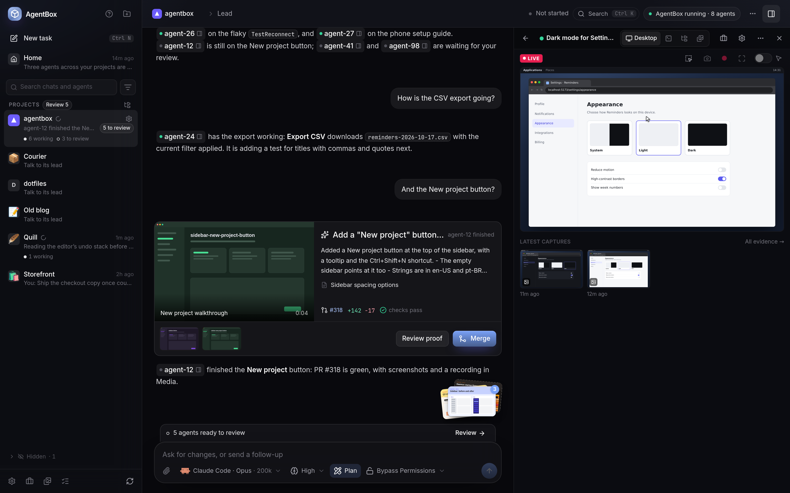
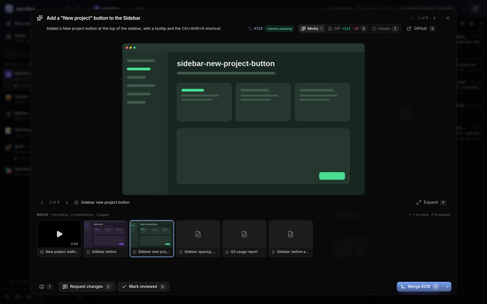
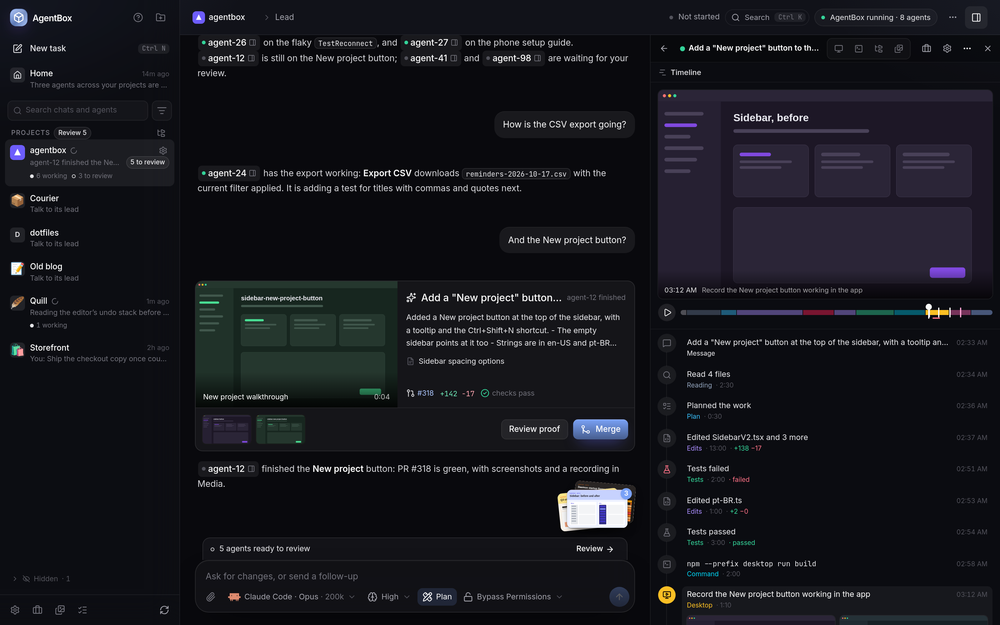
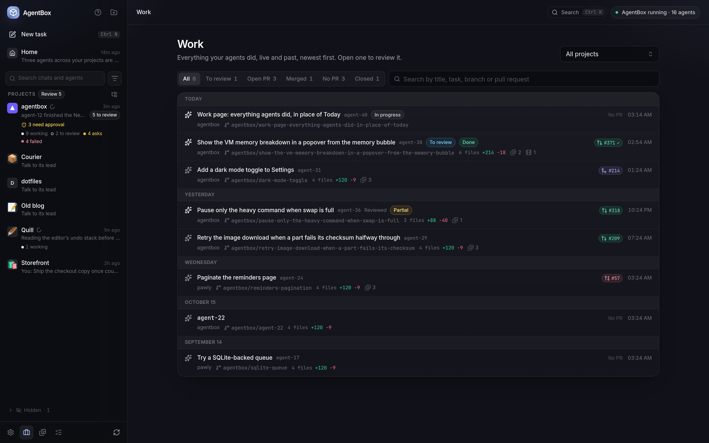

<h1 align="center">AgentBox</h1>

<p align="center">
  <strong>A team of AI coding agents on your own computer, each with a Linux machine of its own, directed by a lead you chat with.</strong>
</p>

<p align="center">
  <a href="https://downloads.agentbox.linting.dev/index.html"></a>
  <a href="https://github.com/leciric/agentbox/actions/workflows/ci.yml"></a>
  <a href="LICENSE"></a>
  
</p>

<p align="center">
  <a href="https://downloads.agentbox.linting.dev/index.html"><strong>Download</strong></a> ·
  <a href="#quick-start"><strong>Quick start</strong></a> ·
  <a href="#how-it-compares"><strong>How it compares</strong></a> ·
  <a href="docs/README.md"><strong>Docs</strong></a>
</p>

<p align="center">
  
</p>

Tell a project's **lead** what you want. It starts the agents the work needs, each one Claude
Code, Codex, OpenCode or Cursor on **a Linux machine of its own**: its own branch and worktree,
Docker, ports and databases, and a desktop with a browser that you can watch live and take over.
Agents test their work in the real app and keep screenshots and recordings as proof, so you
review what they built, not their word for it, and merge from the same window. The lead answers
their questions, passes on the ones only you can answer, and remembers what the project has
learned for the next agent. It all runs on your computer, and it's MIT-licensed.

## Why AgentBox

- **A real machine per agent, not just a worktree.** Each agent gets a Linux container with its own
  network, Docker and every port free, so ten agents can run the same dev server and database at
  once without colliding. Snapshot one, fork a new agent from it, or pause it with its memory
  intact.
- **A desktop and browser for every agent.** Agents click through the app they're changing with a
  real mouse and keyboard. Open an agent's **Desktop** to watch it, and click **Take control** to
  drive it yourself.
- **A lead that directs the agents.** The project's chat creates agents, briefs them, answers
  their questions, sends you the ones that need you, and tells you when the work is ready. You
  talk to one chat, not ten terminals.
- **Proof you can review.** Every agent's work comes with its recording, chapter by chapter, its
  screenshots and test reports, the diff, its pull request and CI, and a timeline of what it did.
  Merge or request changes from the review.
- **Project memory.** What one agent learns (a flaky test, a decision, a setup gotcha) is kept for
  the project, and every new agent starts briefed on it.
- **On your phone.** Pair a phone with a QR code to follow the lead and the agents live, answer
  their questions and merge ([docs/phone.md](docs/phone.md)).
- **Four AI tools, your own accounts.** Claude Code, Codex, OpenCode and Cursor in the same chat,
  with tool calls, diffs, plans and subagents in one timeline. Use several Claude and GitHub
  accounts, and see what each agent spent in tokens.
- **Local and open.** Agents run in a VM on your own computer, with the CPUs and memory you give it,
  so your code stays with you. No account with us, and MIT-licensed.

<table>
  <tr>
    <td width="50%"></td>
    <td width="50%"></td>
  </tr>
  <tr>
    <td align="center"><b>Review</b>: an agent's proof, diff and pull request, then Merge</td>
    <td align="center"><b>Timeline</b>: what an agent did, step by step</td>
  </tr>
  <tr>
    <td colspan="2"></td>
  </tr>
  <tr>
    <td colspan="2" align="center"><b>Work</b>: everything your agents did, live and past, across projects</td>
  </tr>
</table>

## How it compares

Each of these runs coding agents in parallel; they differ in what an agent gets, and in who
directs it. Checked against each product's own site and README in October 2026. ✅ yes,
🟡 partly, — not that we could find. If something here is wrong or out of date,
[open an issue](https://github.com/leciric/agentbox/issues) and we'll fix it.

| | AgentBox | [T3 Code](https://github.com/pingdotgg/t3code) | [Conductor](https://www.conductor.build) | [Claude Squad](https://github.com/smtg-ai/claude-squad) | [Vibe Kanban](https://github.com/BloopAI/vibe-kanban) | [Codex cloud](https://chatgpt.com/codex) |
|---|---|---|---|---|---|---|
| An agent's isolation | Linux container: own network, Docker, ports | Git worktree | Git worktree (cloud sandboxes on Pro) | Git worktree + tmux | Git worktree | Cloud container |
| A desktop and browser per agent you can watch and take over | ✅ | — | — | — | 🟡 browser preview of the dev server | — |
| A lead agent that starts and directs agents | ✅ | — | — | — | — | — |
| Project memory shared by agents | ✅ | — | 🟡 per-workspace notes | — | — | — |
| Recordings and screenshots as proof of work | ✅ | — | — | — | — | — |
| Diff and pull request review | ✅ | ✅ | ✅ | 🟡 diff view | ✅ | ✅ |
| Phone | ✅ | ✅ iOS, Android | 🟡 Pro plan | — | — | ✅ ChatGPT app |
| AI tools | Claude Code, Codex, OpenCode, Cursor | Claude, Codex, Cursor, OpenCode, Grok, Antigravity | Claude Code, Codex, Cursor, OpenCode | Claude Code, Codex, Gemini, Aider, OpenCode, Amp | 10+, Claude Code to Qwen Code | Codex |
| Runs | On your computer, in a VM | On your computer | On your Mac | In your terminal | On your computer | OpenAI's cloud |
| Platforms | Linux; macOS, Windows in alpha | macOS, Windows, Linux, web | macOS | Wherever tmux runs | macOS, Linux, Windows | Web, apps, CLI |
| License and price | MIT, free | MIT, free | Proprietary; free, Pro $50/mo | AGPL-3.0, free | Apache-2.0, free; [sunsetting](https://github.com/BloopAI/vibe-kanban) | Proprietary, with ChatGPT plans |

**Where the others fit better:** a worktree is far lighter than a machine, so T3 Code, Conductor
and Claude Squad need no VM, where AgentBox wants 8 GB of memory and `/dev/kvm`. Claude Squad and
Vibe Kanban drive more AI tools, T3 Code ships for macOS and Windows where AgentBox's builds are
still alpha, and Codex cloud needs no computer of yours at all.

## Quick start

1. [Download AgentBox](#install) and open it. **Setup** makes its VM, gets the agents' base image
   and signs you in to your AI tool.
2. **Add project**, and pick a git repository.
3. **Talk to its lead**: tell it what you want, and it creates the agents it needs, on their own
   branches.
4. Open an agent's **Desktop** tab to watch it work (its browser, its terminal, its file
   manager) and click **Take control** any time.
5. When an agent is done, **Review** opens its recording, screenshots, diff and pull request:
   merge it, or request changes and it carries on.

## Install

AgentBox runs on **Linux, x86_64**, with **macOS and Windows in alpha**. Download the latest release
from [downloads.agentbox.linting.dev](https://downloads.agentbox.linting.dev/index.html):

| File | What |
|---|---|
| `AgentBox-<version>-x86_64.AppImage` | The desktop app, with the `agentbox` command-line tool inside: runs on any distribution |
| `AgentBox-<version>-amd64.deb` | The desktop app, for Debian and Ubuntu |
| `AgentBox-<version>-x64.pacman` | The desktop app, for Arch and its derivatives |
| `AgentBox-<version>-mac-arm64.dmg`, `-mac-x64.dmg` | macOS (alpha), in a Linux VM made with [Lima](https://lima-vm.io): `brew install lima` first |
| `AgentBox-<version>-x64-setup.exe`, `-x64-portable.exe` | Windows (alpha), in a WSL2 distro |
| `SHA256SUMS` | Checksums: `sha256sum -c SHA256SUMS` |

```bash
chmod +x AgentBox-*-x86_64.AppImage
./AgentBox-*-x86_64.AppImage
```

Or `sudo apt install ./AgentBox-<version>-amd64.deb` on Debian and Ubuntu, or
`sudo pacman -U AgentBox-<version>-x64.pacman` on Arch. AppImages need FUSE: install `fuse2` (Arch),
`libfuse2` (Debian 12, Ubuntu 22.04) or `libfuse2t64` (Ubuntu 24.04) if yours won't start. The Mac
and Windows builds are unsigned for now: on a Mac, right-click AgentBox in Applications and choose
**Open** the first time; on Windows, the installer and antivirus may need an exception.

The app's **Setup** walks you through the rest the first time it runs. On Linux, AgentBox runs in a
[Cloud Hypervisor](https://www.cloudhypervisor.org) VM of its own, with the CPUs and memory cap you
give it, so heavy agent work can't freeze your desktop; nothing is installed on your system and no
password is asked. [docs/install.md](docs/install.md) has the details: how the VM shares memory
between agents, moving an installation from before the VM, and the Mac's krunkit VM with a GPU
for agents.

## Requirements and limitations

- **Linux on x86_64**, a Mac, or Windows with WSL2. macOS and Windows are newer and less complete
  than Linux ([docs/install.md](docs/install.md#macos-and-windows-alpha)).
- On Linux: Arch, Debian 12 or 13, Ubuntu 22.04 or newer, or Fedora; 8 GB of memory at least (each
  running agent uses 1–2 GB), 4 cores and 30 GB of free disk; `/dev/kvm`, for AgentBox's VM.
- An account for the AI tool you use: Claude Code, Codex, OpenCode or Cursor.
- Remote environments go through a hub, a separate program that isn't open source; this
  repository carries only its side of the protocol, in [`hubapi/`](hubapi/).
- Each [release](https://downloads.agentbox.linting.dev/index.html)'s notes list what it can't do yet
  under **Known limitations**.

## Privacy

AgentBox checks once a day for a newer release, and with it sends anonymous usage stats: a random
install ID, the version, OS and architecture, counts of which features were used, and anonymous
events such as a turn's length and tokens or an error's code and its redacted wording; never your
names, paths, code or prompts. **Settings → General** shows exactly what the next check would send,
and turns the stats or the whole check off, as do `DO_NOT_TRACK=1` and `AGENTBOX_NO_UPDATE_CHECK=1`.
Problem reports and error reports are sent only when you say so. [docs/privacy.md](docs/privacy.md)
lists every field.

## The command line

Everything in the app has an `agentbox` equivalent, for servers and scripts:

```bash
agentbox add ~/src/my-app                               # a git repository becomes a project
agentbox chat my-app "Paginate the reminders list"      # ask its chat, which creates the agents it needs
agentbox diff my-app/agent-01                           # what an agent changed
agentbox media list my-app/agent-01                     # what it kept to show its work
agentbox share my-app/agent-01 -o run.html              # what it did, as one page to send anyone
```

`agentbox --help` lists the rest; [`docs/`](docs/README.md) has the architecture behind both.

## Built with AgentBox badge

If AgentBox helped build your project, you can say so in its README:

```markdown
[](https://github.com/leciric/agentbox)
```

[](https://github.com/leciric/agentbox)

AgentBox can also end its agents' pull request descriptions with this badge. It is off by default: the
app offers it once, after the first agent pull request is merged, and **Settings → Commits** turns it
on or off.


## Contributing

Bug fixes and small, focused improvements are welcome; for anything bigger, open an issue first.
[CONTRIBUTING.md](CONTRIBUTING.md) covers building the daemon, the CLI and the app, the tests, and
the project's conventions. [AGENTS.md](AGENTS.md) is the codebase tour that AgentBox's own agents
read, and a good one for people too.

## Contributors

Thanks to everyone who has contributed to AgentBox, in order of their first contribution:

- [Vinicius Lourenço](https://github.com/H4ad)
- [Thiago Rodrigues de Oliveira](https://github.com/troliveiraa94)
- [Luis Florido](https://github.com/luisflorido)
- [Kelvin Cluxnei](https://github.com/Cluxnei)
- [Luiz Silva](https://github.com/luizrsilva)

## License

AgentBox is open source under the [MIT License](LICENSE). Copyright (c) 2026 Leandro Ciric.
