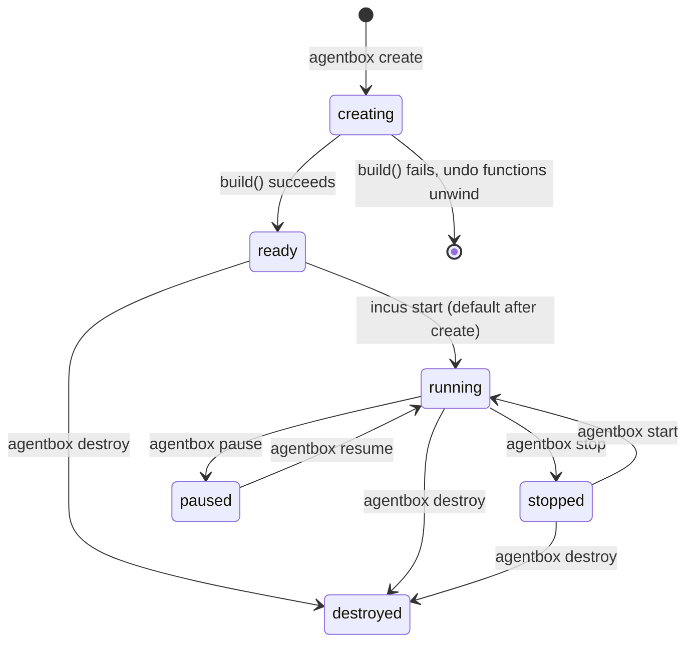
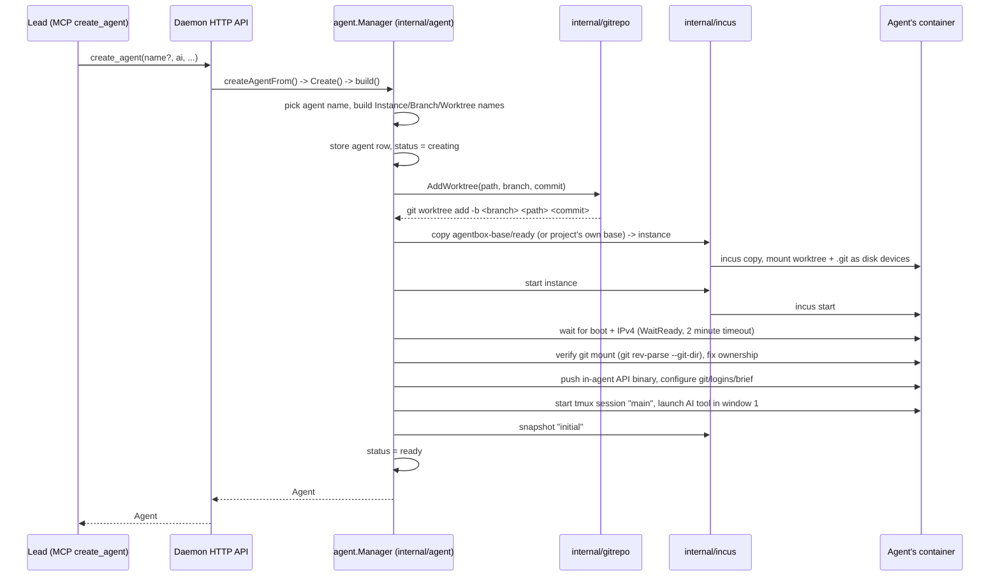
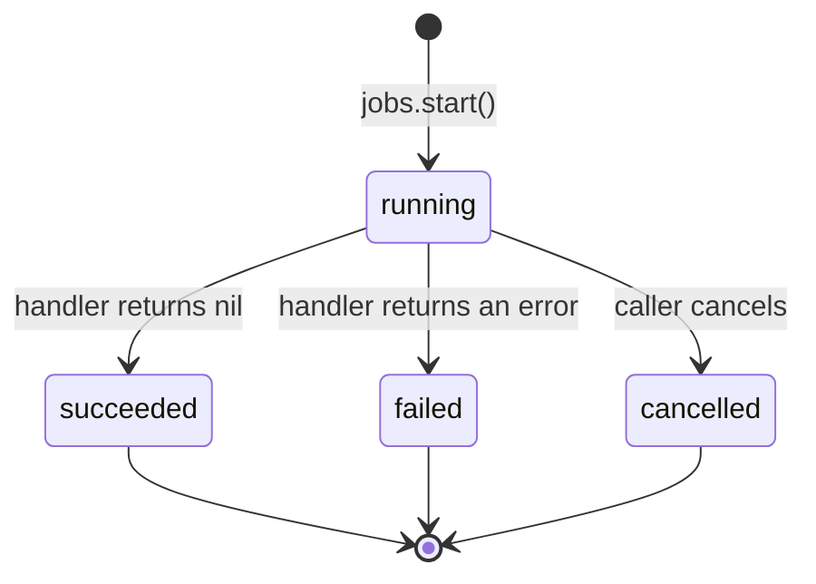

# An agent's lifecycle

[← back to the index](README.md)

An agent is a git worktree, a branch, an Incus container and a tmux session with an AI tool
running in it, all created together by `agentbox create` and torn down together by
`agentbox destroy`. On a Kubernetes cluster the worktree and its home live on a claim instead, and
the machine is a pod: [Agents in a Kubernetes cluster](kubernetes.md) is the user-facing side, and
[the Kubernetes path](#the-kubernetes-path) below is what differs here.

## What an agent is

The `Agent` row (`internal/state/state.go`) has, among others:

- `Project`, `Name` — identity.
- `Instance` — the Incus container name, `"ab-<project>-<agent>"` (`internal/agent/agent.go`).
  Empty for a cluster agent, whose machine is a pod.
- `Branch` — the git branch: the project's branch prefix (`agentbox/` unless it was changed) and the agent's name.
- `Worktree` — the host path, `~/.local/share/agentbox/worktrees/<project>/<agent>`
  (`internal/paths`). Empty for a cluster agent, whose tree is on its claim, in `Workspace`.
- `Status` — `AgentCreating` or `AgentReady` (`state.go`). This is not the container's power
  state: `agentbox stop`/`pause`/`resume` (`internal/agent/agent.go`, `Manager.Stop`/`Pause`/
  `Resume`) act on the Incus instance directly (`incus stop`/`pause`/`resume`) and don't change
  this column. For a cluster agent they write `DesiredState` instead, and the reconciler makes or
  deletes the pod.
- `AI` — which tool it runs: `"claude"`, `"codex"`, `"opencode"`, or `"none"`. An agent that
  names none runs its project's `AgentTool` (`agentbox project tool`), or, when that is inherit,
  the tool the project's chat runs, on the model that chat runs — falling back to Claude Code
  with the reason when that tool can't run where the agent will. A project that pins OpenCode
  must also pin an OpenCode `provider/model` id (`agentbox project model`), never the adapter's
  default.
- `Autonomous` — whether its AI tool starts unattended.
- `Role` — `RoleWorker` for a normal agent, or `RoleLead` for the project's chat, which has no
  Incus instance at all (see [The lead and its MCP tools](lead.md)).
- `ClaudeAccount`, `GitHubAccount`, `Interface`, `FinishNotice` — configuration.

`Status` only ever holds the top row of the diagram (`creating`/`ready`); the container states
below it (`running`/`stopped`/`paused`) are read from Incus, not from `state.db`.

## What a new agent starts on

An agent that names no AI tool follows its project's chat: it runs the chat's tool and account,
on the model and effort that chat's session runs. A project can pin either for all its agents
with `agentbox project model` and `agentbox project effort` (`low`, `medium`, `high`, `xhigh` or
`max`, or `inherit` for the chat's); a model or effort named for one agent as it is created wins
over both. When nobody chose an effort — not the request, not the project, and not a chat whose
tool the agent follows — the installation's default for that tool applies: `medium` for Claude
Code and OpenCode, and Cursor's own default for a model unless Settings names a Cursor effort.
No agent is left on an adapter's own low default.

The effort is only offered by tools whose session advertises the option: Claude Code, OpenCode,
and some Cursor models. A level is checked against the menu that tool last advertised, so one it
never named is refused rather than silently ignored. `Project.AgentEffort` lives in `state.db`
(`agent_effort`, an appended migration), is exposed as `Project.AgentEffort` on the API and in
the app's project settings, and seeds the new agent's chat options exactly like its model.

OpenCode agents run on the Go endpoint (`opencode-go`). An OpenCode account is delivered under
both the `opencode` and `opencode-go` provider names, with the same key, because the same key
authenticates both and OpenCode only lists the Go models when its auth names that provider. A new
OpenCode agent with no model named starts on `opencode-go/deepseek-v4.1-flash`; an `opencode/...`
id inherited from the lead is passed on as the same model on `opencode-go/...`. The model is
checked against the OpenCode menu once one has been remembered. An agent row written before the
switch that still names the old `opencode` provider is resolved to `opencode-go` when that account
now lives there (or the stale entry is dropped so the default resolves), and the corrected map is
written back when the agent is recreated, configured or switched to another account.

## `create_agent`, end to end

Creating an agent is triggered from the lead over its `create_agent` MCP tool (see
[The lead and its MCP tools](lead.md)), or from the CLI/app calling the same daemon endpoint
directly.

Steps, from `build()` in `internal/agent/agent.go`:

1. Pick an agent name if none was given (next free `agent-NN`), and derive `Instance`, `Branch`
   and `Worktree`.
2. Validate the name and check the branch and worktree don't already exist.
3. Store the agent row with `Status = AgentCreating`, registering an undo function.
4. For a Claude Code agent, save its chat defaults.
5. Create the git worktree and branch: `internal/gitrepo`'s `AddWorktree(path, branch, commit)`
   runs `git worktree add --quiet -b <branch> <path> <commit>`; its undo removes the worktree and
   deletes the branch.
6. Optionally copy env files into the worktree.
7. Create the Incus container: copy from a snapshot (the project's own saved base, or
   `agentbox-base/ready` — see [The base image](base-image.md)), strip devices carried over from
   the clone, mount the worktree and its `.git` as disk devices so git crosses the container
   boundary, and start it. `WaitReady()` (`internal/incus`) waits up to
   two minutes for systemd and an IPv4 address.
8. Verify the git mount works (`git rev-parse --git-dir` as the agent user) and fix `.git`
   ownership for tools that write next to it.
9. Push the in-agent API binary and set up its proxy device (`internal/agent/agentapi.go`).
10. Configure git, logins and render the brief into the container (`configure()`; see
    [Project notes and the brief](notes-and-brief.md)).
11. Start the tmux session: `ensureSession()` creates a session named `"main"` with a shell
    window, and — for a CLI-interfaced agent — a second window running the AI tool
    (`toolWindowScript()` in `internal/agent/chat.go`), with an `--autonomous` variant when
    `Autonomous` is set.
12. Take an Incus snapshot named `"initial"`.
13. Set `Status = AgentReady` and return the agent.

Any failure before the last step unwinds through the undo functions registered along the way
(dropping the worktree/branch, the database row, and so on), so a failed create doesn't leave a
half-built agent behind.

## Jobs

Anything this slow runs as a job (`internal/daemon/jobs.go`), so the caller isn't blocked and can
follow progress over the event stream or `GET /v1/jobs`:

`create_agent`, `agentbox image build`, and taking or restoring a snapshot are all jobs; their
result is persisted to the `jobs` table (`internal/state`) once they finish, and the job status
matches `internal/api/types.go`'s `JobRunning`/`JobSucceeded`/`JobFailed`/`JobCancelled`.

## The Kubernetes path

An agent created with `--cluster <name>` runs on a cluster instead of this host, and `build()`
(`internal/agent/agent.go`) skips the steps above that make a machine here. The row is written with
`Cluster`, `Runtime = "kubernetes"`, `Workspace = "/workspace"`, `DesiredState = "running"` and an
empty `Worktree`, and no worktree is created on this host. The daemon's reconciler
(`internal/daemon/reconciler.go`) makes the pod from that row within its next five-second round;
`build()` then waits up to five minutes for the pod's `agentd` to open its gateway session
(`podReadyTimeout`), and configures the agent as it does on a host: the git profile is cloned into
the pod (`clonePodGit`, `internal/agent/gitprofile.go`), the brief is written, and the tmux session
starts. Everything after that reaches the machine over the gateway, since this host has no path to
it.

The claim is the machine, and the pod is a use of it. One claim holds `/workspace` and
`/home/agent`, so the worktree, the home, the tools' state and the uncommitted work stay when the
pod goes (`internal/k8s/spec.go`; the workspace is `internal/workspace/pod.go`). That is why the
operations below keep the agent's work:

- `stop` sets `DesiredState = "stopped"`, which the reconciler reads as "delete the pod"; the claim
  stays (`podLifecycle.Stop`, `internal/daemon/pods.go`).
- `start` sets it back to `"running"`, and the next round makes a new pod on the same claim.
  `Manager.Start` waits for its session and writes the secrets, the git config, the brief and the
  tmux session into it again.
- `pause` has no pod equivalent: `podMachine.Pause` answers `machine.ErrNotSupported` and
  `Manager.Pause` stops the pod instead, which is what frees the memory a pause is for. The row
  still records the pause, and `resume` starts it (`internal/machine/kubernetes.go`,
  `internal/agent/agent.go`).
- `destroy` deletes the pod, its token Secret and its claim, in that order, and then archives the
  row (`destroyMachine`, `internal/daemon/pods.go`). Nothing of the claim is kept.
- `recreate` replaces the pod and keeps the claim (`podLifecycle.Recreate`,
  `internal/daemon/pods.go`): the row is stopped, the pod is deleted and waited for, and the row's
  pod and pinned image are cleared so the new pod runs the cluster's current image.
  `Manager.recreatePod` (`internal/agent/recreate.go`) waits for the session and writes the env,
  the git config, the brief and the tmux session again, because none of those were on the claim.
- `move` is a claim archive and restore across clusters (`internal/daemon/move.go`,
  `moveAgentRun`). It checkpoints the worktree and publishes the branch first when the pod is running
  (a stopped agent's worktree is only in the claim), stops the source pod so the claim can be read,
  streams it through `ArchiveClaim` into `RestoreClaim` on the target with a helper pod in each
  cluster, and writes the row onto the new claim with `store.MoveAgent`. The reconciler makes the
  target pod, and the move is done when that pod answers the gateway and `Start` has configured it.
  Only then are the source pod, its token and its claim removed.

The token is minted per pod and dies with it. `startPod` (`internal/daemon/reconciler.go`) makes 32
random bytes, writes them to `agent_tokens` as a SHA-256 and puts the plaintext in the pod's Secret
before the pod is made, so a token the daemon never issued is refused. A stop deletes the pod and
its token (`clearPod`), and a recreate removes the old token before the new pod is asked for
(`podLifecycle.Recreate`), so every start has a new one.
