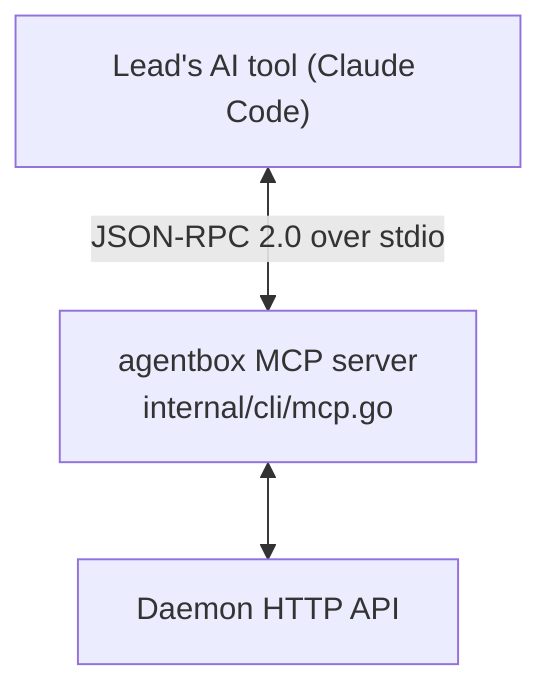

# The lead and its MCP tools

[← back to the index](README.md)

## What the lead is

The lead is a project's own chat: it directs the project's agents but never does the work itself,
and it has no machine of its own — it runs on the host. Concretely, it's still an `Agent` row
(`internal/state`), with `Role = state.RoleLead` and `Name = state.LeadName`
(`internal/daemon/lead.go`), just one with no Incus instance and no worktree.

- `leadFromPath()` (`internal/daemon/lead.go`) returns an ephemeral lead for a read that doesn't
  need to persist one.
- `ensureLeadFromPath()` creates a persistent lead row on first write — so a project nobody has
  ever chatted with costs nothing.
- The lead's chat always runs Claude Code (`ChatTool = "claude"`, `internal/agent/chat.go`).

You reach the lead through the app's chat tab (backed by the daemon's
`/projects/{project}/chat` API), or with `agentbox ask` from the CLI
(`internal/cli/ask.go`) — the same command an agent uses to ask the lead a question mid-task
(see [Chat over ACP](chat.md)).

## Sessions

A project's chat has sessions: each is a lead conversation of its own on one topic ("Prod: login
500s"), with its own context, compaction and prompt cache. A project has as many as you open, and
can have none. The chat you had before sessions is the first one, "Chat", and can be deleted like
any other.

- **Shared by every session:** notes, memory, skills, schedules, the repository and the agent list.
- **Each session's own:** its conversation, what it is working on in `project_state`, and the
  agents it made. Their finish, stall and failure notices, their questions and their pull request
  watch go to that session only.
- **Notices about nobody's agent** (one you made, or one whose session was deleted), schedules,
  other projects' leads and CI go to the session most recently active. A project with no session
  opens one for an event that needs a turn, titled after it.
- **Another session's agent:** a lead may read it freely. Telling it something or retiring it asks
  you first, on a card in that lead's chat. To move an agent for good, use "Move to session" in its
  menu, or `agentbox chat session hand`.
- **Deleting a session** removes its conversation and leaves its agents to no session. Nothing is
  summarised: the lead writes what matters to memory as it goes.
- **Keeping the cache warm:** a session gets keepalives only while its own agents are working.
  When its cache is about to expire, the card that offers to compact it also offers to start a
  new session, which takes the message you were writing as its first.

In the app, the sessions are tabs above the chat and a list under the project in the sidebar. Each
shows a spinner while its lead works and a dot when it has news you haven't seen. The keys are
<kbd>Ctrl</kbd>+<kbd>T</kbd> for a new session and <kbd>Ctrl</kbd>+<kbd>Shift</kbd>+<kbd>⌫</kbd> to
delete the one shown (it asks first, in the tab). <kbd>Ctrl</kbd>+<kbd>Tab</kbd> and
<kbd>Ctrl</kbd>+<kbd>Shift</kbd>+<kbd>Tab</kbd> move between sessions. The phone shows them as
chips above the chat.

```bash
agentbox chat session list pawly
agentbox chat session new pawly "Prod: login 500s"
agentbox chat pawly --session prod-login-500s "Is the fix deployed?"
agentbox chat session close pawly prod-login-500s
agentbox chat session hand pawly/agent-07 prod-login-500s
```

`agentbox chat pawly`, without `--session`, uses the session most recently active.

## Writing to an agent from the chat

The **To:** chip at the left of the chat's composer says who a message goes to: the lead, which
is the default, or any agent of the project. It lists the session's own agents first, then the
project's others, each with a dot for its state.

- A message to an agent goes straight to that agent's chat, the same as typing in it. It shows
  in the lead's chat as your message tagged "→ agent-31". The lead isn't woken: it reads
  "User told agent-31: …" at the start of its next turn, so it stays in sync and spends nothing.
- A message to **another session's** agent asks first, in place of the send: "agent-12 belongs
  to “Prod incident”. Send anyway?"
- <kbd>Ctrl</kbd>+<kbd>.</kbd> and <kbd>Ctrl</kbd>+<kbd>Shift</kbd>+<kbd>.</kbd> move the
  target to the next and the previous agent (<kbd>⌘</kbd> on a Mac), and <kbd>Esc</kbd> in an
  empty composer goes back to the lead. Starting a message with `@agent-31 ` sends just that
  message to agent-31.
- Each session remembers its target. If that agent is retired, the target goes back to the lead.

The phone has the same chip and `@agent-31 `. From the command line:

```bash
agentbox chat pawly --to agent-31 "Use the new reminders table"
```

## Its MCP tools

The lead's AI tool is given an MCP server, `agentbox`, registered from
`internal/cli/mcp.go`. Its tools are how the lead acts on the project — creating and directing
agents, reading and writing project memory, managing notes, and answering the questions agents
escalate to it.



The model is sent every tool's name, description and schema with each call it makes, so the list
is kept short: a family of operations on one thing is one tool, with an `action` argument.

**Agents**
- `create_agent` — create a new agent (title, task, branch, AI tool, model, effort, account,
  connectors). See [An agent's lifecycle](agent-lifecycle.md).
- `list_agents` — list the project's agents and their status, or its past (archived) ones.
- `tell_agent` — send a message into a running agent's chat.
- `read_agent` — read an agent's chat transcript, or (`show`) its diff or the diff's summary.
- `run_in_agent` — run a shell command inside an agent's machine.
- `copy_to_agent` — copy a file or directory into an agent's machine, from another agent's
  machine (`from`) or from one of the user's projects on the host.
- `retire_agent` — stop, pause or destroy an agent once it has finished; its work stays on its branch.
- `checkpoints` — list an agent's checkpoints, roll it back to one, or fork a new agent from one.
- `fan_out`, `compare_group` — run one task on several agents as a group the user compares, and
  compare them (with `recommend`, record which one the lead would keep).

**Project memory**
- `search_memory` — full-text search over memories, events and reports (see
  [Project memory](memory.md)).
- `remember` — write a memory (kind, title, content, importance), optionally superseding an
  older one.
- `memory_feedback` — mark a memory wrong, stale or helpful, or `resolved`: closed without
  replacing it (a bug got fixed, something stopped mattering).
- `project_state` — where the project stands: working memory, open issues, recent reports. Given
  fields (goal, current task, active agents, blockers, notes), it updates the working memory.

**Project notes**
- `notes` — read the project's notes, and add, edit or remove an entry under the lead's own
  `## From the lead` section (see [Project notes and the brief](notes-and-brief.md)); `promote`
  and `dismiss` answer an offer in the lead's brief to make a memory many agents were handed into
  a note (see [Memories that could be notes](memory.md#memories-that-could-be-notes)).

**Questions, skills, schedules and other projects**
- `questions` — the other side of `agentbox ask`: list what agents have asked, answer one, or
  escalate one to the user.
- `skills` — list, read, create, edit, switch on or off, and delete skills.
- `schedules` — create, list, edit, pause, resume and delete scheduled tasks.
- `message_project` — message another project's lead, align with it on a topic, reply in a
  thread, settle an alignment, and list the threads.

**Accounts, secrets, connectors and issues**
- `list_resources` — the accounts available to the project and their current usage limits (see
  [The token ledger](tokens.md)), the names of its secrets (never their values) and which of them
  the lead manages, its connectors, or its open GitHub issues.
- `switch_agent_account` — move an agent to another account of its AI tool, keeping its conversation.
- `questions` with `fulfil` — answer an agent's request for a secret marked "managed by the lead",
  with the value AgentBox has stored for it. The lead names the request and never sees or sends the
  value; any other credential request stays the user's.

Two further MCP servers exist for an agent's own AI tool, not the lead's:

- `agentbox-memory` (`internal/cli/memory.go`) — `search_memory`,
  `report`, `record_artifact`: an agent's narrower view of memory, scoped to its own task.
- `agentbox-desktop` (`internal/cli/desktop.go`) — the desktop/browser tools an agent's AI tool
  uses to see and drive its virtual display.

All three speak MCP (JSON-RPC 2.0, protocol version `2024-11-05`) over the AI tool's stdin/stdout,
implemented against the shared `Tool` type in [`internal/mcp/mcp.go`](../internal/mcp/mcp.go)
(`Name`, `Description`, `Schema`, `Run`).
