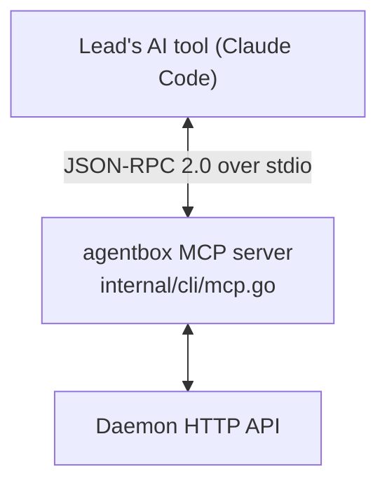

# The lead and its MCP tools

[← back to the index](README.md)

## What the lead is

The lead is a project's own chat: it directs the project's agents but never does the work itself,
and it has no machine of its own — it runs on the host. Concretely, it's still an `Agent` row
(`internal/state`), with `Role = state.RoleLead` and `Name = state.LeadName`
(`internal/daemon/lead.go`), just one with no Incus instance and no worktree.

- `leadFromPath()` (`internal/daemon/lead.go`) returns an ephemeral lead for a read that doesn't
  need to persist one.
- `ensureLeadFromPath()` creates a persistent lead row on first write — so a project nobody has
  ever chatted with costs nothing.
- The lead's chat always runs Claude Code (`ChatTool = "claude"`, `internal/agent/chat.go`).

You reach the lead through the app's chat tab (backed by the daemon's
`/projects/{project}/chat` API), or with `agentbox ask` from the CLI
(`internal/cli/ask.go`) — the same command an agent uses to ask the lead a question mid-task
(see [Chat over ACP](chat.md)).

## Its MCP tools

The lead's AI tool is given an MCP server, `agentbox`, registered from
`internal/cli/mcp.go`. Its tools are how the lead acts on the project — creating and directing
agents, reading and writing project memory, managing notes, and answering the questions agents
escalate to it.

The model is sent every tool's name, description and schema with each call it makes, so the list
is kept short: a family of operations on one thing is one tool, with an `action` argument.

**Agents**
- `create_agent` — create a new agent (title, task, branch, AI tool, model, effort, account,
  connectors). See [An agent's lifecycle](agent-lifecycle.md).
- `list_agents` — list the project's agents and their status, or its past (archived) ones.
- `tell_agent` — send a message into a running agent's chat.
- `read_agent` — read an agent's chat transcript, or (`show`) its diff or the diff's summary.
- `run_in_agent` — run a shell command inside an agent's machine.
- `copy_to_agent` — copy a file or directory into an agent's machine, from another agent's
  machine (`from`) or from one of the user's projects on the host.
- `retire_agent` — stop, pause or destroy an agent once it has finished; its work stays on its branch.
- `checkpoints` — list an agent's checkpoints, roll it back to one, or fork a new agent from one.
- `fan_out`, `compare_group` — run one task on several agents as a group the user compares, and
  compare them (with `recommend`, record which one the lead would keep).

**Project memory**
- `search_memory` — full-text search over memories, events and reports (see
  [Project memory](memory.md)).
- `remember` — write a memory (kind, title, content, importance), optionally superseding an
  older one.
- `memory_feedback` — mark a memory wrong, stale or helpful, or `resolved`: closed without
  replacing it (a bug got fixed, something stopped mattering).
- `project_state` — where the project stands: working memory, open issues, recent reports. Given
  fields (goal, current task, active agents, blockers, notes), it updates the working memory.

**Project notes**
- `notes` — read the project's notes, and add, edit or remove an entry under the lead's own
  `## From the lead` section (see [Project notes and the brief](notes-and-brief.md)); `promote`
  and `dismiss` answer an offer in the lead's brief to make a memory many agents were handed into
  a note (see [Memories that could be notes](memory.md#memories-that-could-be-notes)).

**Questions, skills, schedules and other projects**
- `questions` — the other side of `agentbox ask`: list what agents have asked, answer one, or
  escalate one to the user.
- `skills` — list, read, create, edit, switch on or off, and delete skills.
- `schedules` — create, list, edit, pause, resume and delete scheduled tasks.
- `message_project` — message another project's lead, align with it on a topic, reply in a
  thread, settle an alignment, and list the threads.

**Accounts, secrets, connectors and issues**
- `list_resources` — the accounts available to the project and their current usage limits (see
  [The token ledger](tokens.md)), the names of its secrets (never their values) and which of them
  the lead manages, its connectors, or its open GitHub issues.
- `switch_agent_account` — move an agent to another account of its AI tool, keeping its conversation.
- `questions` with `fulfil` — answer an agent's request for a secret marked "managed by the lead",
  with the value AgentBox has stored for it. The lead names the request and never sees or sends the
  value; any other credential request stays the user's.

Two further MCP servers exist for an agent's own AI tool, not the lead's:

- `agentbox-memory` (`internal/cli/memory.go`) — `search_memory`,
  `report`, `record_artifact`: an agent's narrower view of memory, scoped to its own task.
- `agentbox-desktop` (`internal/cli/desktop.go`) — the desktop/browser tools an agent's AI tool
  uses to see and drive its virtual display.

All three speak MCP (JSON-RPC 2.0, protocol version `2024-11-05`) over the AI tool's stdin/stdout,
implemented against the shared `Tool` type in [`internal/mcp/mcp.go`](../internal/mcp/mcp.go)
(`Name`, `Description`, `Schema`, `Run`).
