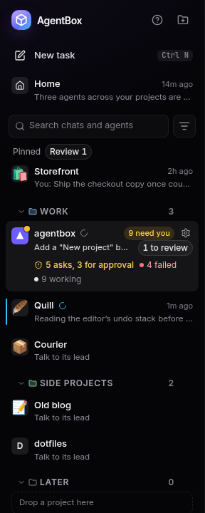
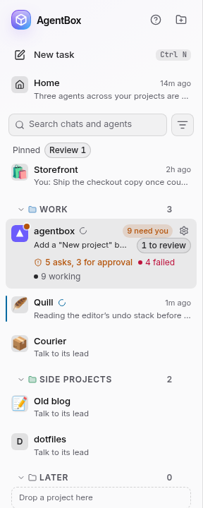
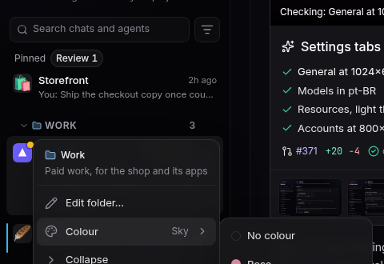
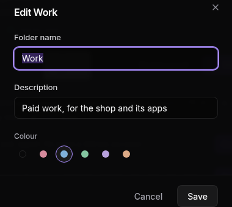
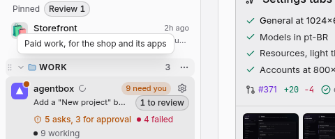
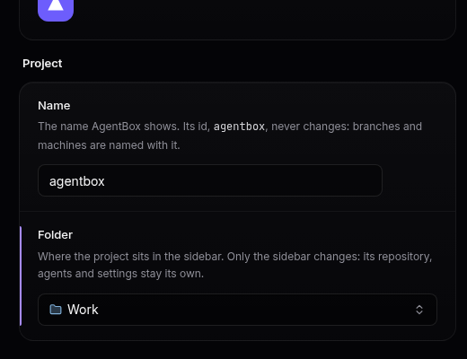

# Project folders

Folders group projects in the sidebar. They are only for organising: a project in a folder keeps
its own repository, branches, agents, chat and settings, and taking it out changes none of them.
A folder has a name, a colour and an optional description, and the sidebar remembers its order and
whether it is folded. That is kept by AgentBox itself, so every window, and another machine on the
same AgentBox, shows the sidebar the same way.

An installation that never makes a folder looks as it always has: projects outside folders stay in
the **Projects** list, where they are now.

  
  

## Make a folder

Click the folder icon at the right of the **Projects** heading (its tooltip says **New folder**),
type a name and press <kbd>Enter</kbd>. <kbd>Esc</kbd>, or clicking away, cancels, so nothing empty
is left behind. The new folder goes at the end of the folders.

Right-clicking a project also offers **Move to folder › New folder…**, which makes the folder with
that project already in it.

## Name, colour and description

Point at a folder's heading and click its **⋯**. The menu starts with the folder's name and, when it
has one, its description.

- **Colour** picks one of five colours, or none, straight from the menu. The folder's icon takes it.
- **Edit folder…** opens the folder's name, description and colour together. The description is one
  line of up to 200 characters, and it is optional.

The description is the folder's tooltip: point at its name in the sidebar to read it.

## Put projects in and take them out

- **Drag a project** onto a folder's heading to put it at the top of that folder, or between two
  projects of a folder to put it there. While you drag a project that is in a folder, a **Drop here
  for no folder** box appears: drop it there, or anywhere in the **Projects** list, to take it out.
- **Drag a folder** by its heading to move it, with everything in it, among the other folders.
- **From the keyboard**, <kbd>Alt</kbd>+<kbd>↑</kbd> and <kbd>Alt</kbd>+<kbd>↓</kbd> move the
  focused project or folder; past the end of one list is the start of the next.
- **Right-click a project**: **Move to folder** lists the folders and **No folder**.
- **From the project's Settings**, **Folder** sits under the project's name: pick a folder, or **No
  folder**. The project goes to the end of the folder you pick.

A pinned project shows under **Pinned**, and a hidden one under **Hidden**, wherever its folder is.

## Fold a folder

Click a folder's heading, or use **Collapse** and **Expand** in its menu, to fold it to one line;
the number beside the name says how many projects are inside. With the heading focused,
<kbd>←</kbd> folds it and <kbd>→</kbd> unfolds it. A folded folder stays folded after a restart. A
search or a filter opens it on what matches, and a project moved into a folded folder unfolds it,
so a move is never hidden.

## Delete a folder

**Delete folder**, in its menu, asks first and says how many projects are in it. Deleting a folder
deletes only the folder: its projects go back to the **Projects** list, and nothing about them
changes.

## Exports

[Exporting a project](export-import.md) carries its folder's name, colour and description.
Importing it puts the project back in a folder of that name, made if there is none.
